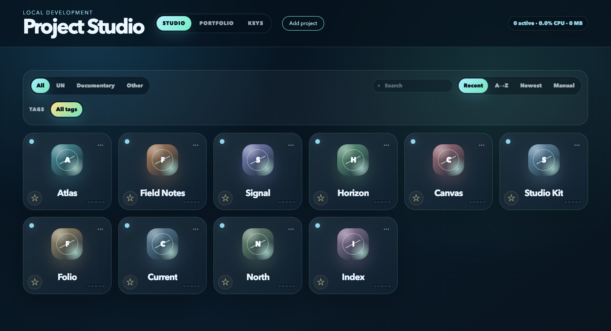
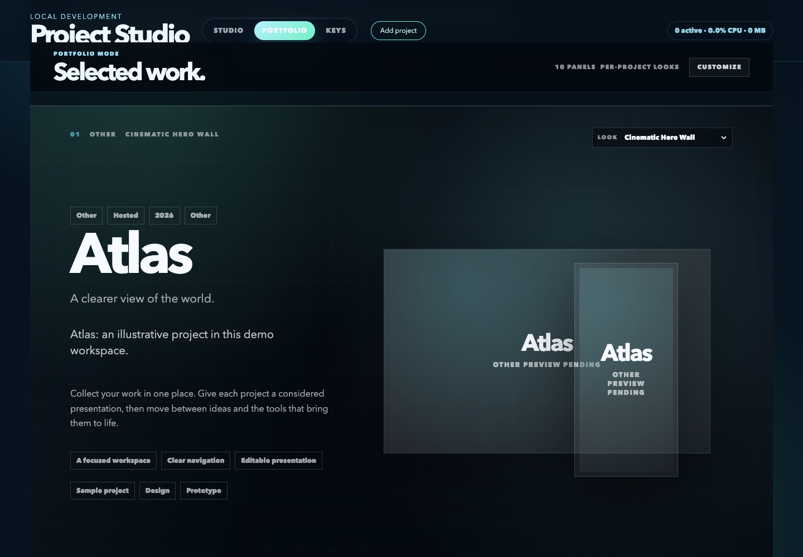
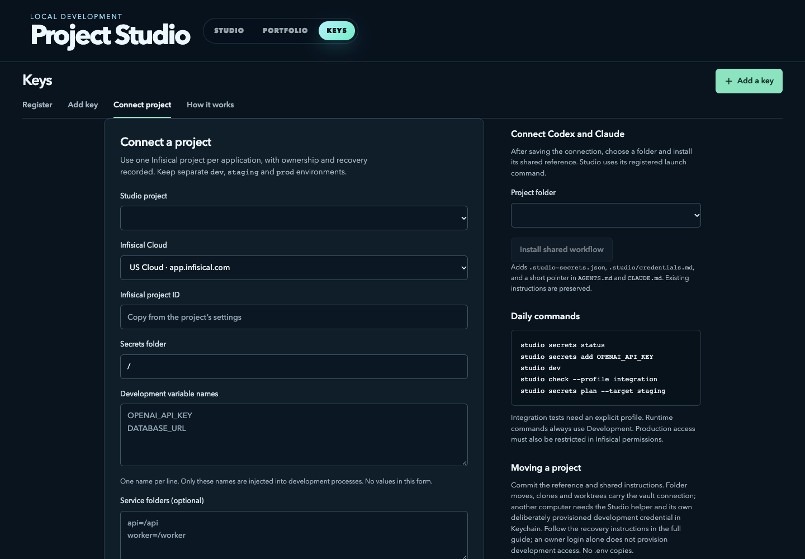

<div align="center">

# Project Studio
### Your projects. One local workspace.

**Launch tools · Shape a portfolio · Connect development keys**

[Explore](https://ben-keller.github.io/project-studio/) · [Releases](https://github.com/Ben-Keller/project-studio/releases) · [Release status](docs/release/STATUS.md) · [Agent skill](integrations/skills/project-studio/SKILL.md)

**macOS 13+ · Apple Silicon · MIT · Local-first**

</div>

---

Project Studio brings local applications, prototypes and hosted tools into a native
macOS workspace. Keep your projects where they already live. Launch them deliberately,
see what is running, and turn working software into a portfolio.

## Download and install

**[Download Project Studio for Mac (.dmg)](https://github.com/Ben-Keller/project-studio/releases/download/v0.2.1-preview.1/Project-Studio-0.2.1-macOS-arm64-preview.dmg)** · [All releases](https://github.com/Ben-Keller/project-studio/releases)

1. Download and double-click the `.dmg` file.
2. Drag **Project Studio** into **Applications**.
3. Open **Project Studio** from Applications, then choose **Add project** to add your tools.

**Requires macOS 13 or newer and an Apple Silicon Mac (M-series). Intel Macs are not supported.**
Python and the interface are bundled: no Terminal setup is needed for Project Studio
itself. Individual projects may still require their own dependencies. A fresh install
starts with an empty library; your project code stays in its original folders.

**Preview warning:** this build is ad-hoc signed, **not Apple-notarized**. macOS may
block it from opening. Do not disable Gatekeeper globally. Apple signing and
notarization are still required for a frictionless public installation.

Updating an existing installation? Quit Project Studio before replacing it in
Applications. Your workspace data is stored separately and is not replaced by the app.

## Connect your assistant and add projects

The optional connector is a **skill for Codex or Claude Code** that teaches your
assistant how to register and manage projects through Studio's supported commands.
It does not upload your projects or set up a credential provider.

### 1. Install the connector

With Project Studio installed in Applications, open **Terminal** and run the command
for your assistant. You can install both if you use both tools.

**Codex**

```sh
"/Applications/Project Studio.app/Contents/MacOS/studio" integrations install --agent codex
```

**Claude Code**

```sh
"/Applications/Project Studio.app/Contents/MacOS/studio" integrations install --agent claude
```

Existing skills are not overwritten silently. Start a new assistant session after
installation so it can discover the skill.

### 2. Register an existing project

Open the project's folder in Codex or Claude Code and ask:

> Add this project to Project Studio. Inspect how it runs, validate the launch
> configuration, and show me the commands for approval before registering it.

The assistant checks the project's launch commands, working folders and ports,
then registers it after your approval. Registration does not start the project.
Reload Project Studio to see its new card, then launch it from there. Repeat for
each project you want to add; your code stays in its original folder.

Your projects still need their own dependencies and any required credentials.
Installing the connector does not install those or configure the optional Keys view.

**Prefer to do it yourself?** Use **Add project** in Studio to register a hosted URL
or a local app with its launch configuration. No coding assistant is required.

### 3. Organize your categories

Choose a **Category** when adding a project, such as Work, Personal or Research.
Type a new name to create one, or choose an existing name. Category tabs are built
from your library, not a preset list. Leave the field blank for **Uncategorized**.
Use **Edit categories** beside the filters to move existing projects, rename a
category by changing its projects' names, or remove it by clearing/reassigning its
projects. Empty categories disappear automatically. Categories are saved locally
and included in workspace backups. When using the assistant, ask it to include
your preferred `category` in the project registration.

| Studio | Portfolio | Keys |
|:---|:---|:---|
| Organize projects, launch apps, inspect resources and stop servers. | Present selected work through ten layouts and project-level customization. | Track credential references and connect supported Infisical development workflows. |

## A look inside

### Your working library
Filter, arrange and open your projects from one place.



### From workspace to portfolio
Give each project its own presentation, with editable layouts and device frames.



### Connect development keys
Keep project access explicit without putting secret values in your catalog.



These are real interface captures using a fictional demo workspace. Personal projects
and credentials are not included. Portfolio placeholders are illustrative, not live apps.

## Preview status

This repository is the **public collaboration preview**, not a completed production
release. The native Apple Silicon preview bundles Python and the main UI. It is
ad-hoc signed, **not Apple notarized**; macOS may block downloaded builds. Do not disable
Gatekeeper globally. Apple-signed installation remains a release gate. Update checks use Sparkle and
EdDSA-signed releases; installation requires confirmation. See the operations guide
for migration, backup and update verification.

Project Studio includes the launcher, Portfolio and Keys views. Screen recording and
video export are not part of this app. See [the release checklist](docs/release/STATUS.md)
for remaining integration and migration work.

## Run from source

```sh
git clone https://github.com/Ben-Keller/project-studio.git
cd project-studio
python3 local_tools_launcher.py --open
```

Use Python 3.11 or newer. A fresh checkout starts with an empty catalog: it contains
no personal projects, credentials, recordings, browser profiles or private inventories.
Use **Add project** to register a URL and optional local launch command. Dependencies
for your own projects are managed by those projects.

## Source-checkout CLI setup

One portable skill supports both agents. From the repository:

```sh
python3 studio_cli.py integrations install --agent codex
python3 studio_cli.py integrations install --agent claude
```

For the downloaded app, use the [connector setup above](#connect-your-assistant-and-add-projects).
These commands are for developers running from a source checkout.

```sh
python3 studio_cli.py doctor
python3 studio_cli.py projects validate examples/project.json
```

Edit the example with your folder and command, review it, then register with
`projects add examples/project.json --trust-commands`. Registration does not execute
commands. Reload Studio after CLI registration.

## Build the macOS preview

Build on Apple Silicon with Xcode Command Line Tools and Python 3.13:

```sh
python3 -m venv release/.venv
release/.venv/bin/pip install -r release/requirements.txt
release/.venv/bin/python release/build_macos.py --dmg
```

Build output: `release/build/Project Studio.app` and an ARM64 preview DMG.
No Intel release is provided. The existing source-linked developer installer remains
available; it is not the distributable build.

## Data and privacy

Installed app state lives in `~/Library/Application Support/Project Studio/`.
Source runs use ignored `outputs/` unless `PROJECT_STUDIO_DATA_DIR` is set.
Credential values belong in Keychain or your vault, not project manifests or Git.
Nothing automatically imports or publishes your local project library.

Migration is opt-in: `import-workspace PATH` previews copies and `--apply` copies into
an empty destination. Source data is preserved. Browser preferences and provider access
still require separate review; see [release status](docs/release/STATUS.md).

## Contributing

### Repository layout

| Folder | Responsibility |
|:---|:---|
| `app/` | Internal services, catalog, authentication and workspace storage |
| `assets/` | Studio, Portfolio and Keys interfaces |
| `desktop/` | Native macOS wrapper |
| `scripts/` | Optional screenshot and media utilities |
| `tests/` | Unit, browser and native smoke tests |
| `docs/` | Documentation and README screenshots |
| `release/` | Packaging and publication tooling; generated builds are ignored |
| `integrations/` | Portable agent skill |
| `examples/` | Example project registration |
| `site/` | Public website and update feed |

The stable entry points remain `local_tools_launcher.py` and `studio_cli.py` at the
root, alongside the source-linked installers and static servers. Existing launch
commands do not change. Runtime state is separate from source and remains ignored.

README screenshots can be regenerated with `node scripts/capture_readme.cjs` when
Playwright and Chrome are available. The script uses a disposable demo catalog and
does not launch your projects or alter your settings.

Keep the local-first architecture: Python service, native WebKit shell, vanilla Studio/
Portfolio/Keys UI. Prefer small, tested changes over
framework rewrites. Include reproducible steps and sanitized logs in bug reports.

```sh
python3 -m unittest discover -s tests -p 'test_*.py'
node --check assets/studio.js
node --check assets/portfolio.js
```

Never attach keys, private inventory files or browser profiles to an issue.

## License

Original Project Studio code is licensed under [MIT](LICENSE). Dependencies retain their
own licenses. Personal project photos, logos and inventories are not distributed here.

## Workspace migration and maintenance

See [installation, migration, backups and publishing](docs/release/OPERATIONS.md).
